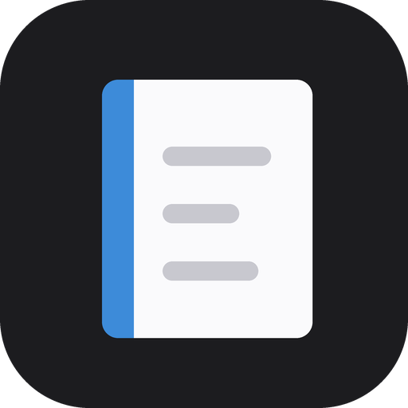

<p align="center"></p>

# Sidenote for AI assistants

Let Claude, ChatGPT, Gemini, Codex, Cursor or any other [MCP](https://modelcontextprotocol.io) app read and edit your [Sidenote](https://elmagoct.github.io/sidenote-privacy/) notepads, with your Sidenote sync key.

Ask things like *“what's left on my groceries list?”*, *“tick off eggs”*, *“turn this chat into a notepad under Trip plan”* or *“find my notes about the robot arm”*. Changes appear in Sidenote on every synced computer within seconds.

| Tool | What it does |
|---|---|
| `list_notepads` | The notepad tree, with ids and a short preview |
| `search_notepads` | Full-text search across titles and content |
| `read_notepad` | One notepad as Markdown (or its stored HTML) |
| `create_notepad` | A new notepad, or a subpad of one |
| `update_notepad` | Rename, change accent colour, replace, append or prepend content |
| `edit_notepad` | Find and replace text, leaving the rest untouched |
| `organize_notepad` | Star or archive |

Nothing is ever deleted through these tools; archiving is the furthest they go.

## No account, no setup: sidenote-sync.netlify.app

**[sidenote-sync.netlify.app](https://sidenote-sync.netlify.app/)** works with any AI, on any plan:

- **Chat apps** (ChatGPT, Claude, Gemini, free plans included): open your notes there with your sync key, tap **Link for chat apps**, and paste the link into the chat. The chat reads every notepad as plain text. The link is read only and works until you [turn links off](https://sidenote-sync.netlify.app/oauth/disconnect).
- **Agents with a terminal** (Claude Code, Codex, Gemini CLI, Cursor…): the `sidenote` CLI is one file with no install. It reads and edits, and notes are decrypted on your computer.

  ```bash
  curl -fsSL https://sidenote-sync.netlify.app/sidenote.mjs -o sidenote.mjs
  node sidenote.mjs key sync-xxxxx-xxxxx-xxxxx-xxxxx-xxxxx   # once, in your own terminal
  node sidenote.mjs all                                      # every notepad
  node sidenote.mjs tick Groceries eggs
  ```

- **Sidenote on the web:** [sidenote-sync.netlify.app/notes](https://sidenote-sync.netlify.app/notes/) opens your notepads in any browser, on any device, to read and edit, with the same editor as the extension. A `pad-` or `view-` key opens just that shared notepad. The key goes in the address after `#` (which browsers never send to a server), so bookmark the page to come back.
- **For the AI itself:** [sidenote-sync.netlify.app/llms.txt](https://sidenote-sync.netlify.app/llms.txt) explains all of this, plus every CLI command and the Markdown dialect, to any assistant that opens it.

## Your sync key

In Sidenote, open the full view → **Settings → Sync & devices**. Turn sync on if it's off, then press **Show** next to the sync key (`sync-xxxxx-xxxxx-xxxxx-xxxxx-xxxxx`). Anyone with this key can read and edit all your notepads, so only paste it where these instructions say.

## Two ways to connect

- **Hosted connector** at `https://sidenote-sync.netlify.app/mcp`, for apps that connect by URL (ChatGPT, claude.ai, the Gemini app). You sign in on Sidenote's own page, so the AI app never sees your key. Notes are decrypted on the connector, in memory, only while a request is answered. Choose **Read only** at sign-in if the assistant should never change anything.
- **Local server** (this repo's `server/index.js`), for apps that run tools on your computer (Claude Code, Claude Desktop, Gemini CLI, Codex). Your key stays on your computer and notes are decrypted there; the sync service only ever sees encrypted data. Set `SIDENOTE_READ_ONLY=1` for read-only.

## Install

### Claude Code
```bash
claude plugin marketplace add ElMagoCT/sidenote-mcp
```
```bash
claude plugin install sidenote@sidenote
```
Claude Code asks for your sync key and keeps it in your system keychain. Runs locally.

### Claude Desktop
Download `sidenote.mcpb` from the [latest release](https://github.com/ElMagoCT/sidenote-mcp/releases/latest), open **Settings → Extensions**, drop the file in, and paste your sync key. Runs locally.

### claude.ai (web, desktop and mobile)
**Customize → Connectors → Add custom connector**, URL `https://sidenote-sync.netlify.app/mcp`, then **Connect** and sign in with your sync key.

### ChatGPT
At [chatgpt.com/plugins](https://chatgpt.com/plugins), press **+ → Add custom MCP server**, URL `https://sidenote-sync.netlify.app/mcp`, authentication **OAuth**, then sign in with your sync key. Which ChatGPT plans can add custom servers is up to OpenAI ([help article](https://help.openai.com/en/articles/12584461)).

### Codex
```bash
codex mcp add sidenote --url https://sidenote-sync.netlify.app/mcp
```
```bash
codex mcp login sidenote
```
Or as a plugin: `codex plugin marketplace add ElMagoCT/sidenote-mcp`, then `/plugins` in Codex.

### Gemini CLI
```bash
gemini extensions install https://github.com/ElMagoCT/sidenote-mcp
```
It asks for your sync key and keeps it in your system keychain. Runs locally. Antigravity CLI: `agy plugin install https://github.com/ElMagoCT/sidenote-mcp`.

### Gemini app
**Settings → Connected apps → Add a custom app**, URL `https://sidenote-sync.netlify.app/mcp`, then sign in. (Google offers custom apps to personal accounts in the US, 18+.)

### Cursor, VS Code, Windsurf and other MCP apps
Hosted (the app opens the sign-in page):
```json
{ "mcpServers": { "sidenote": { "url": "https://sidenote-sync.netlify.app/mcp" } } }
```
Local (needs Node 20+ and git; on npm 12 add `--allow-git=root` after `-y`):
```json
{
  "mcpServers": {
    "sidenote": {
      "command": "npx",
      "args": ["-y", "github:ElMagoCT/sidenote-mcp"],
      "env": { "SIDENOTE_SYNC_KEY": "sync-xxxxx-xxxxx-xxxxx-xxxxx-xxxxx" }
    }
  }
}
```
Apps that only take a header can skip sign-in by sending `Authorization: Bearer <your sync key>` to the hosted URL (add `X-Sidenote-Read-Only: 1` for read-only).

## Sidenote Markdown

Notepads are read and written as Markdown that maps one-to-one onto Sidenote's editor, so an assistant can change one line without disturbing anything else. Each line is its own paragraph. On top of the usual headings, emphasis, links, lists, `- [ ]` to-dos, quotes, tables and code blocks:

| Markdown | In Sidenote |
|---|---|
| `==text==`, `<u>text</u>` | highlight, underline |
| `[Title](sidenote:<id>)` | a link to another notepad |
| `<details><summary>Title</summary>` … `</details>` | a toggle |
| `## Heading <!--fold-->` | a folded heading |
| a line with only `<br>` | an empty line |
| `<time data-at="1767254400000">Jan 1, 9:00 AM</time>` | a reminder (epoch ms) |
| `<span data-m="person">Ana</span>` | a mention (`person` or `place`) |

## Privacy and security

- Sidenote has no accounts. Everything is reached with your sync key, and notepads are stored on the sync service encrypted with AES-256-GCM under keys derived from it.
- **Local server:** your key and your notes stay on your computer. It sends the sync service only what the Sidenote extension itself sends: hashes, write tokens and ciphertext.
- **Hosted connector:** you type your key into Sidenote's sign-in page. It is sealed (AES-256-GCM, under a secret only the connector holds) into the tokens the AI app keeps, so the app never sees it. The connector stores no keys and no notes; it decrypts what a request needs in memory and forgets it. Access tokens last an hour and renew for up to 180 days. [Disconnect AI apps](https://sidenote-sync.netlify.app/oauth/disconnect) signs every app out of an account within an hour.
- **Links for chat apps:** making one sends your key to the connector once, which seals it into the link (the key never appears in it). When a chat opens the link, the connector decrypts your notepads in memory to answer and stores nothing. Anyone with the link can read your notes until you [turn links off](https://sidenote-sync.netlify.app/oauth/disconnect) (that also signs out connected apps). Links are marked `noindex`.
- **CLI and Sidenote on the web:** both decrypt on your own device, like the local server. The CLI also takes a shared notepad's `pad-` or `view-` key.
- Whatever an assistant reads is sent to that AI provider (Anthropic, OpenAI, Google…) under its own privacy policy.
- Full policy: [elmagoct.github.io/sidenote-privacy](https://elmagoct.github.io/sidenote-privacy/#ai) · [Terms](https://elmagoct.github.io/sidenote-privacy/terms.html) · Questions and bugs: [issues](https://github.com/ElMagoCT/sidenote-mcp/issues)

## How it works

`src/keys.js` derives the same ids, write tokens and AES keys as the extension. `src/client.js` reads the encrypted account index and notepads from the sync service and writes back with compare-and-swap, so a write never overwrites an edit it hasn't seen; the extension merges anything typed meanwhile. `src/md.js` converts between the editor's HTML and Markdown without a DOM. `src/tools.js` and `src/rpc.js` are the MCP layer (no SDK, no dependencies), served over stdio by `server/index.js` and over Streamable HTTP with OAuth 2.1 (client ID metadata documents or dynamic registration, PKCE) by `src/remote.js`, which runs as a Netlify Edge Function next to the sync service and also serves the chat links. `server/cli.js` is the CLI (bundled into one file by `scripts/build-cli.sh`), and `web/` is the page at sidenote-sync.netlify.app, which loads `src/` straight into the browser.

```bash
npm test                    # converter, tools, OAuth, links and CLI against an in-memory sync service
./scripts/build-cli.sh      # dist/sidenote.mjs, the one-file CLI the website serves
./scripts/build-mcpb.sh     # dist/sidenote.mcpb for Claude Desktop
```

MIT licensed.
